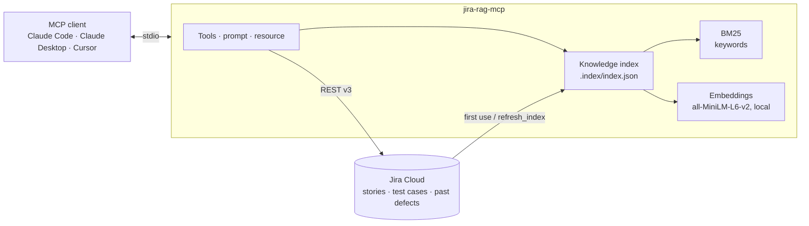

# jira-rag-mcp

[](https://github.com/KKoygun/jira-rag-mcp/actions/workflows/ci.yml)

An MCP server that gives an AI assistant QA context: it reads Jira stories, and searches **test cases and past defects by meaning** (RAG) to answer the question a tester asks first, *"which acceptance criteria of this story are not tested yet, and did any of them break before?"*

It complements Atlassian's official MCP server: that one reads and edits Jira; this one searches your test knowledge and finds gaps.

---

## Example

`check_coverage KAN-10` on the story *"Edit a todo inline"*, against the demo data in a real Jira Cloud project. This is the part for the third of its four acceptance criteria, as returned:

```
## AC3: Pressing Escape cancels the edit and keeps the original text
Closest test cases:
1. KAN-11 [Test case · Done · linked to KAN-10] Test: Double-click opens the edit field with the current text  (similarity 0.45)
     (details above)
2. KAN-12 [Test case · Done · linked to KAN-10] Test: Enter saves the edited text  (similarity 0.41)
     (details above)
Related past defects:
1. KAN-13 [Past defect · Done · linked to KAN-10] Escape kept the half-typed text instead of discarding the edit  (similarity 0.69)
     (details above)
2. KAN-9 [Past defect · Done] Pressing Enter on a field with only spaces created an empty todo  (similarity 0.38)
     (details above)
```

Each issue's details are printed once, the first time it matches. Earlier in the same output, under AC1 and AC2, the two test cases' expected results read *"An edit field appears containing "Buy milk"…"* and *"The item now reads "Buy oat milk""*, and KAN-13 reads:

```
1. Double-click an item
2. Type extra characters
3. Press Escape
Expected: The item shows its original text
Actual: The changed text was saved
Root cause: Escape left edit mode, which fired blur, and the blur handler saved the field
```

Neither of the closest test cases presses Escape, and the closest past defect is an Escape bug. The assistant reads that as: **untested, and it broke before**, the riskiest kind of gap. The `gap_analysis` prompt asks it to do this for every criterion and draft the missing tests.

### In practice

Asked in Claude Code to *"do a test gap analysis for KAN-10"*, the assistant called the server five times and answered:

| AC | Criterion | Covered by | Verdict |
|---|---|---|---|
| AC1 | Double-click turns the text into an edit field | KAN-11, on an active item | **Partly covered**: a finished item is never tried, and KAN-14 broke exactly there |
| AC2 | Enter *or leaving the field* saves the *trimmed* text | KAN-12, Enter only | **Partly covered**: leaving the field and trimming are never tested |
| AC3 | Escape cancels and keeps the original text | none | **Not covered**, and KAN-13 broke it before |
| AC4 | Saving empty text deletes the todo | none | **Not covered** |

It also noted that KAN-7 and KAN-8, the blank-input and trimming tests, *"look like matches on wording, but they test the new todo field, not the edit field"*: the case the retrieval alone cannot tell apart, settled by reading the expected results. It then drafted seven test cases, ranked the gaps by risk, and said it created nothing in Jira, since the tools are read-only.

## What the server offers

| | Name | What it does |
|---|---|---|
| Tool | `get_story` | A story with its acceptance criteria and its linked test cases and past defects |
| Tool | `search_stories` | Stories by words and status (JQL; user text is escaped) |
| Tool | `search_test_assets` | **RAG:** test cases, past defects and stories by meaning and by exact words |
| Tool | `check_coverage` | **RAG:** for each acceptance criterion, the closest test cases and past defects in the whole project, linked or not, with their steps and expected results |
| Tool | `refresh_index` | Re-reads Jira; only changed issues are embedded again |
| Prompt | `gap_analysis` | Tells the assistant to combine the tools and draft the missing tests |
| Resource | `jira://{key}` | A story as Markdown, for clients that let you attach context directly |

Everything is read-only: nothing in the server can change a Jira issue.

## How it works



- **One document per issue.** Stories, test cases and defects are short; splitting them further would cut acceptance criteria away from their story.
- **Local embeddings.** `all-MiniLM-L6-v2` runs inside Node (8-bit ONNX, about 23 MB, downloaded once). No API key, no cost, the same vectors on every machine.
- **Hybrid search.** BM25 catches exact terms (`Escape`, `#/active`, `localStorage`), embeddings catch paraphrases (*"page refresh"* ↔ *"reload"*). The two rankings are merged with reciprocal rank fusion, which needs no tuning between their score scales.
- **Incremental index.** Saved to `.index/`; a refresh re-embeds only issues whose text changed.
- **How test cases and defects are found.** Stories plus issues labelled `test-case` or `past-defect` (change it with `RAG_JQL`). A plain Jira project has no "Test" issue type, so test cases are Tasks with a label.

## Measured, not assumed

`npm run eval:retrieval` asks 22 hand-labelled questions against the demo corpus (35 issues), offline: no Jira, no key. Most questions are worded differently from the issues they should find (*"pluralisation bug in the items left label"* → *Footer said "1 items left"*).

| Mode | recall@1 | recall@3 | recall@5 | MRR |
|---|---|---|---|---|
| **Hybrid (used)** | **86%** | **91%** | 91% | **0.88** |
| Embeddings only | 77% | 91% | 95% | 0.84 |
| BM25 only | 82% | 91% | 91% | 0.85 |

Hybrid puts the right issue first most often, which is what matters when an assistant reads the top results. CI runs the eval and fails if hybrid recall@5 drops below 85%.

The two questions it still misses are honest limits of a small model: *"reopening a finished todo"* does not find *"Unticking a done todo"*, and *"line through them"* does not find *"struck through"*.

**Two findings that changed the design:**

1. **Adding the story's title to each test case ("contextual retrieval") did not help.** Recall@5 went up by one question and recall@3 down by one; with 22 questions that is noise. It stays off, and the eval keeps measuring it.
2. **Similarity cannot decide coverage.** Scoring every acceptance criterion against its best test case, a real gap ("Saving an empty text deletes the todo") scored 0.66 against a test about blank input, while covered criteria about `localStorage` scored 0.43. Any threshold would give confident wrong answers. So `check_coverage` returns evidence (expected results, linked or not, related defects) and the assistant judges; the `gap_analysis` prompt tells it not to go by the score.

Unit and MCP contract tests (37) drive the server through a real MCP client over an in-memory connection, with a fake Jira and a fake embedder: tool and resource listing, input schemas, errors, the index being built once and refreshed incrementally.

## Demo data

`npm run seed:jira` puts a TodoMVC QA history into a Jira project ([`seed/todomvc.ts`](seed/todomvc.ts)): 9 stories, 18 test cases and 8 past defects, each linked to its story. Coverage differs on purpose:

| Story | Test cases | Past defects | Gap |
|---|---|---|---|
| Edit a todo inline | 2 | 2 | Escape and empty text untested; a defect hit Escape |
| Filter todos by status | 3 | 1 | "kept after reload" untested; a defect hit exactly that |
| Search todos by text | 0 | 0 | new story, nothing covers it |
| six more | 1–4 | 0–1 | covered |

Every issue carries the label `rag-demo` and its own `seed-<id>` label, so running the seed again creates nothing. `--dry-run` prints the plan without calling Jira.

## Setup

Requires Node.js 22+ and a Jira Cloud site with an [API token](https://id.atlassian.com/manage-profile/security/api-tokens).

```bash
git clone https://github.com/KKoygun/jira-rag-mcp
cd jira-rag-mcp
npm install
cp .env.example .env          # JIRA_BASE_URL, JIRA_EMAIL, JIRA_API_TOKEN, JIRA_PROJECT
npm run seed:jira             # optional: the demo data above
npm run build
```

### Connect it

The server speaks MCP over stdio. Point your client at the built entry point, with an absolute path; it reads `.env` from the project folder itself.

**Claude Code** (the client it was tested with)

```bash
claude mcp add jira-rag -- node /absolute/path/to/jira-rag-mcp/dist/src/index.js
```

Then, in a session in that folder: `/mcp__jira-rag__gap_analysis KAN-10`, or just ask for a gap analysis.

**Claude Desktop, Cursor** and other clients that take a JSON server list (same command, not tested here):

```json
{
  "mcpServers": {
    "jira-rag": {
      "command": "node",
      "args": ["/absolute/path/to/jira-rag-mcp/dist/src/index.js"]
    }
  }
}
```

The first search builds the index from Jira (about 1.5 seconds for the demo data; the model download adds a few seconds the very first time).

## Development

```bash
npm test                  # unit and MCP contract tests, no network
npm run typecheck
npm run eval:retrieval    # retrieval eval on the seed corpus, real model, no Jira
npm start                 # the server from source, over stdio
```

## Limits

- Jira Cloud only (REST v3, API token); no Data Center.
- The corpus and the question set are small. The eval shows the search works end to end and where it fails; it is not a benchmark.
- Coverage is judged by the assistant from the evidence, so its quality depends on the model in your client.

## Related repositories

| Repository | Description |
|---|---|
| [Playwright-cucumber-ai-framework](https://github.com/KKoygun/Playwright-cucumber-ai-framework) | UI automation for the same TodoMVC app, with AI agents and a measured healer eval |
| [defect-bridge](https://github.com/KKoygun/defect-bridge) | Posts Allure test failures to the linked Jira tickets and flags regressions |
| [playwright-api-framework](https://github.com/KKoygun/playwright-api-framework) | REST API tests with Zod validation and Pact contract tests |
| [TypeDojo](https://github.com/KKoygun/TypeDojo) | TypeScript curriculum with validated challenges and a recorded AI review eval |
